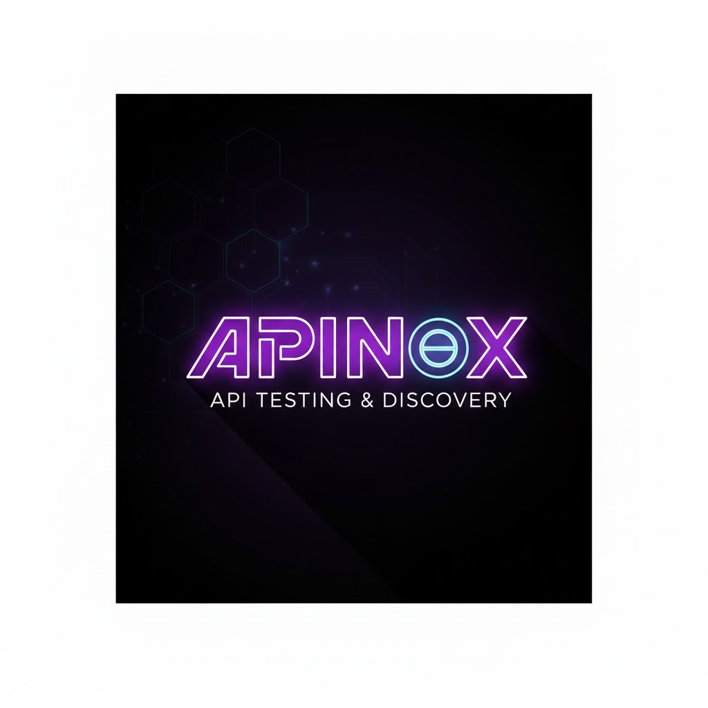

# APInox

A visual SOAP client and API testing desktop app — Tauri v2 (Rust backend) with a React webview. Load WSDLs (or OpenAPI documents), build and send requests, automate test runs, intercept traffic, and keep notes, all in one app.



Inspired by Bruno and SOAP-UI, aimed at people who actually have to work with enterprise SOAP services (WCF, `Service.svc?wsdl`, self-signed dev boxes, corporate proxies).

## The app at a glance

The sidebar rail switches between the main views:

- **Explorer** — the primary surface. Projects hold interfaces from a WSDL or an OpenAPI import (plus manual projects). Load WSDLs from URL or file, recursively resolving `<xsd:import>`/`<wsdl:import>`, refresh/sync against the source URL, and pick which operations to add. Quick Requests and History are sub-windows inside this view.
- **Tests** — test cases and suites. Step types: request, delay, condition, loop, script, and nested test cases. Values are extracted from responses with XPath, regex, JSONPath, or header match, then reused via `{{var}}` / `${var}`. Renaming a variable rewrites every reference to it. Right-click for **Edit as JSON** (raw editor as a workspace tab). A **Test Case Wizard** builds a case from captured traffic.
- **Performance** — performance suites that repeat request sequences to measure throughput and latency (configurable concurrency, warmup runs, per-request SLA). Percentiles, success rate, and SLA breaches computed from every real call; run history retained between sessions.
- **Traffic** — the built-in HTTP/HTTPS interceptor and mock server (features merged in from the old standalone APIprox app, which no longer exists). Proxy mode logs traffic with breakpoints and in-flight replace rules; Mock mode answers predefined rules without hitting real servers. HTTPS interception works via the app's own CA certificate. A **System Proxy** toggle routes OS traffic through it while running. Right-click a capture to add it to the Explorer operation its WSDL/OpenAPI match identifies.
- **Notes** — a markdown scratchpad with find and replace (`Ctrl+F` / `Ctrl+H`).
- **Settings** — tabbed settings (General, Environments, Globals, Integrations, Updates, About) with a raw JSON editor.

## Feature notes

- **WCF / enterprise friendly** — TLS verification can be skipped for self-signed dev/test servers, and WSDL loads can be routed through the proxy. Detailed network logging for debugging.
- **Environments and secrets** — named environments (Dev/Test/Prod) with custom fields, switched from the sidebar. Fields marked as secret are encrypted at rest (AES-256-GCM in `~/.apinox/secrets.enc`), masked in the UI, resolved transparently as variables, and redacted on export.
- **Request editor** — SOAP envelopes auto-generated from the parsed XSD schema tree, XML syntax highlighting, per-request endpoint URL, `{{...}}` wildcards including date math and custom JavaScript.
- **Import** — SoapUI 5.x workspaces/projects import into APInox format.
- **Keyboard** — `Ctrl+S` saves the focused pane, or all dirty projects when nothing has focus; `Ctrl+Shift+D` opens the Debug modal (backend logs, frontend logs, system info, connection test).
- **Platforms** — Windows, macOS, Linux (Tauri builds in CI, with Arch packaging and AppImage bundles).

## Quick start

1. Install APInox (releases ship platform installers from GitHub Actions).
2. In **Explorer**, add a project from a WSDL URL or file (or an OpenAPI document).
3. Add operations, then create a request (right-click an operation, or Quick Request).
4. Edit the XML/JSON body, point at an endpoint, hit **Run**.
5. Set up an environment in **Settings → Environments** for variables and secrets.

Full walkthrough and wildcard syntax: see [manual.md](./manual.md) and the in-app **Help panel**.

## Repository layout

| Path | What it is |
|------|------------|
| `src-tauri/` | The app: Rust backend (commands, proxy, mock, soap, testing, performance, storage) and `webview/` (React UI) |
| `shared/` | Types and utils shared between the webview and other consumers |
| `packages/wsdl-parser/` | Standalone Rust crate — the WSDL/SOAP parser (see below) |
| `docs/` | Design notes and build/troubleshooting docs |
| `learning/` | A self-contained HTML course on SOAP/WSDL/WCF fundamentals |
| `Samples/` | Example WSDL (complex types) and sample project folders |
| `images/` | Logo and screenshots |
| `scripts/` | Versioning, test runner, lint baseline, Tauri init helpers |
| `CHANGELOG.md` | Release changelog |
| `TODO.md` | Live feature backlog |
| `manual.md` | User manual |
| `PKGBUILD` + `distrobox.assemble` | Arch packaging paths |

## Development

```bash
npm install
npm run tauri:init          # install webview deps + fetch Rust workspace crates
npm run tauri:dev           # Vite dev server + Tauri debug build
npm run test                # vitest for shared/ and src-tauri/webview separately
npm run lint                # eslint, compared against lint-baseline.json
npm run tauri:build         # production build and platform bundles
```

- Node >= 20.19 (CI uses Node 22); Rust via the workspace `Cargo.toml` (`src-tauri` + `packages/wsdl-parser`).
- The app version is `major.minor` from `package.json` plus a patch derived from the commit count (`scripts/version.js`), so a given commit always builds the same version.

## Standalone WSDL parser

The parsing logic lives in [`packages/wsdl-parser/`](./packages/wsdl-parser/) as its own Rust crate so other tools (e.g. a SOAP mock server) can use it without pulling in Tauri:

- Parses WSDL 1.1: services, bindings, port types, operations
- Recursively resolves remote schema imports
- Builds typed XSD schema trees for generating request envelopes
- Detects SOAP 1.1 / SOAP 1.2 bindings
- Exposes what a mock server needs: operation name, `SOAPAction`, endpoint URL, input schema

See [packages/wsdl-parser/README.md](./packages/wsdl-parser/README.md) for the full API.

## Security notes

- Secrets are encrypted at rest in `~/.apinox/` and redacted as `[REDACTED]` on export; don't commit real credentials to shared environment files.
- The proxy CA certificate is for local development/testing only — install it into the trust store only on machines you control, and never rely on TLS-verification bypass for production traffic.

## Roadmap

Current priorities live in [TODO.md](./TODO.md) (OpenAPI response validation gaps, test data sets, traffic-to-operation matching refinements); shipped features are tracked in [CHANGELOG.md](./CHANGELOG.md).
